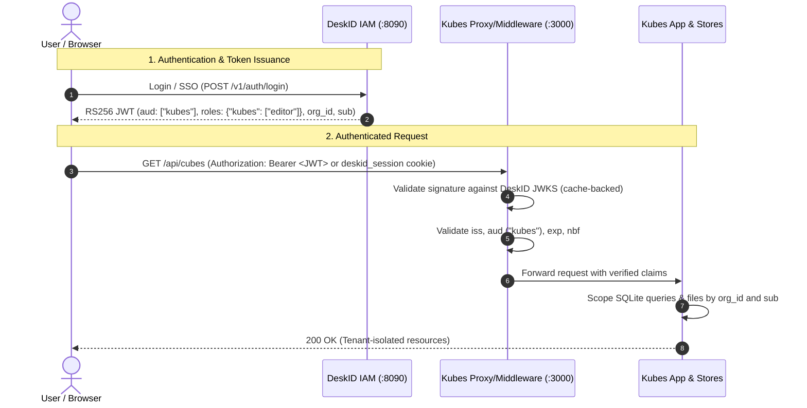

# DeskID Client Integration Guide for Kubes

> **Target System:** Kubes Autonomous Agentic Workstation (`bots`)  
> **Identity Provider:** DeskID IAM Control Plane (`deskid`)  
> **Status:** Production Standard Integration Guide  

---

## 1. Overview & Architecture

DeskID serves as the centralized, product-agnostic Identity & Access Management (IAM) engine. Kubes operates as a downstream client application that relies on DeskID for identity verification while enforcing its own resource-level authorization.

### Division of Responsibility

| System | Role | Primary Responsibilities |
| :--- | :--- | :--- |
| **DeskID** | Identity Provider (IdP) | User authentication, passwordless & OAuth login, multi-tenant organization memberships, RS256 token signing, and public JWKS (`/.well-known/jwks.json`) publishing. |
| **Kubes** | Downstream Client & Resource Server | Stateless cryptographic verification of JWTs, internal `AuthContext` creation, multi-tenant SQLite database scoping, and filesystem/browser workspace isolation. |



---

## 2. Step 1: Register Kubes in DeskID

Before Kubes can accept DeskID tokens, register `kubes` as an audience in DeskID's **Service Registry**.

### Option A: Via DeskID Admin Console
1. Navigate to `http://127.0.0.1:8090/admin` (or your central DeskID host).
2. Log in with a platform administrator account.
3. Select **Services** in the sidebar and click **+ Register service**.
4. Configure the service fields:
   - **Audience ID:** `kubes`
   - **Service Name:** `Kubes Autonomous Workstation`
   - **Allowed Roles:** `viewer, editor, admin`
   - **Default Role:** `editor`
5. Save the service.

### Option B: Via DeskID Admin API
Execute an authenticated request using an admin access token:

```bash
curl -X POST http://127.0.0.1:8090/v1/admin/services \
  -H "Authorization: Bearer $ADMIN_TOKEN" \
  -H "Content-Type: application/json" \
  -d '{
    "id": "kubes",
    "name": "Kubes Autonomous Workstation",
    "description": "Autonomous agent workstation and compute runtime",
    "allowed_roles": ["viewer", "editor", "admin"],
    "default_role": "editor"
  }'
```

---

## 3. Step 2: Configure Access Grants in DeskID

Users must hold a product grant for `kubes` to access the application.

### Method 1: Automatic Grants for All Users (Recommended for Open Access)
In your DeskID deployment `.env` file, append `kubes` to `AUTH_DEFAULT_AUDIENCES`:

```env
AUTH_DEFAULT_AUDIENCES="deskid,kubes"
AUTH_DEFAULT_ROLE="editor"
```

### Method 2: Manual User / Organization Grant
Grant access to a specific user across all organizations (global) or scoped to a specific tenant:

```bash
# Organization-Scoped Grant
curl -X POST http://127.0.0.1:8090/v1/admin/grants \
  -H "Authorization: Bearer $ADMIN_TOKEN" \
  -H "Content-Type: application/json" \
  -d '{
    "user_id": "usr_948a28f1",
    "audience": "kubes",
    "role": "editor",
    "org_id": "org_tenant_1"
  }'
```

---

## 4. Step 3: Configure Kubes Environment Variables

In the Kubes workspace, configure `.env.local` (or container environment):

```env
# Enable DeskID IAM mode (defaults to 'none' for single-user local mode)
AUTH_MODE=deskid

# DeskID Central Service Endpoints
DESKID_ISSUER=http://127.0.0.1:8090
DESKID_JWKS_URL=http://127.0.0.1:8090/.well-known/jwks.json
DESKID_AUDIENCE=kubes

# (Optional) Static Public Key override for air-gapped/local test suites
# DESKID_PUBLIC_KEY="-----BEGIN PUBLIC KEY-----\n..."
```

---

## 5. Step 4: Token Verification & Proxy Flow

Kubes implements token verification in `lib/auth/deskid.ts` using the `jose` library and routes incoming requests through `proxy.ts`.

### Expected Token Claims Contract

```json
{
  "sub": "usr_948a28f1",
  "email": "user@example.com",
  "org_id": "org_tenant_1",
  "roles": {
    "kubes": ["editor"]
  },
  "iss": "http://127.0.0.1:8090",
  "aud": "kubes",
  "iat": 1760000000,
  "exp": 1760003600
}
```

### Proxy Routing Behavior (`proxy.ts`)
- **Public Routes:** `/_next/*`, `/favicon.ico`, `/login`, `/api/auth/*` pass through without challenge.
- **API Requests (`/api/*`):** Missing or invalid tokens immediately return `401 Unauthorized` with JSON error payloads.
- **Web Requests:** Missing or invalid tokens redirect browser users to DeskID login:
  ```text
  http://127.0.0.1:8090/login?redirect=http://127.0.0.1:3000/...
  ```
- **Token Sources:** Inspects `Authorization: Bearer <token>` header first, falling back to the `deskid_session` cookie.

---

## 6. Step 5: Server-Side Route Protection & Auth Context

Protected route handlers and server actions should resolve verified identity using a unified server helper:

```typescript
// lib/auth/context.ts
import { getAuthMode, validateDeskIDToken } from "@/lib/auth/deskid";

export interface AuthContext {
  mode: "local" | "deskid";
  userId: string | null;
  orgId: string;
  roles: string[];
}

export async function requireAuth(request: Request): Promise<AuthContext> {
  const mode = getAuthMode();
  if (mode !== "deskid") {
    return {
      mode: "local",
      userId: null,
      orgId: "default",
      roles: ["admin"],
    };
  }

  const authHeader = request.headers.get("authorization");
  const cookieHeader = request.headers.get("cookie");
  
  let token = authHeader?.startsWith("Bearer ") ? authHeader.slice(7).trim() : null;
  if (!token && cookieHeader) {
    const match = cookieHeader.match(/deskid_session=([^;]+)/);
    if (match) token = match[1];
  }

  if (!token) {
    throw new Response(JSON.stringify({ error: "Missing authentication token" }), {
      status: 401,
      headers: { "Content-Type": "application/json" },
    });
  }

  const validation = await validateDeskIDToken(token);
  if (!validation.valid || !validation.claims?.sub || !validation.claims.org_id) {
    throw new Response(JSON.stringify({ error: validation.error || "Invalid token claims" }), {
      status: 401,
      headers: { "Content-Type": "application/json" },
    });
  }

  return {
    mode: "deskid",
    userId: validation.claims.sub,
    orgId: validation.claims.org_id,
    roles: validation.claims.roles?.kubes || [],
  };
}
```

---

## 7. Step 6: Multi-Tenant Resource Scoping & RBAC

All data access inside Kubes must strictly enforce the caller's verified `orgId` and `userId`.

### 1. Database Scoping (SQLite)
Never allow un-scoped queries or request-body overrides:
```typescript
// Correct: Scoped by verified context
export function getCube(id: string, scope: AuthContext) {
  return db.prepare("SELECT * FROM cubes WHERE id = ? AND org_id = ?").get(id, scope.orgId);
}

// User-owned resources (e.g. personal memories)
export function getMemory(id: string, scope: AuthContext) {
  return db.prepare("SELECT * FROM memories WHERE id = ? AND org_id = ? AND user_id = ?")
    .get(id, scope.orgId, scope.userId);
}
```

### 2. Filesystem & Computer Workspace Scoping
Workspaces and task downloads are isolated by organization and user directory structures:
```text
data/computer/
  orgs/<org-id>/
    users/<user-id>/
      cubes/<cube-slug>/
      chrome/<task-id>/
      shots/<task-id>/
```

### 3. Role-Based Access Control (RBAC)
Enforce role boundaries prior to executing state mutations or agent execution tools:

| Operation | `viewer` | `editor` | `admin` |
| :--- | :---: | :---: | :---: |
| Read Cubes, threads, messages | Yes | Yes | Yes |
| Create / edit Cubes & schedules | No | Yes | Yes |
| Execute agent tools & computer actions | No | Yes | Yes |
| Configure AI providers & gateway secrets | No | No | Yes |
| Delete organization data & manage tenants | No | No | Yes |

---

## 8. Verification & Validation Steps

### 1. Verify DeskID JWKS Endpoint
Confirm DeskID is serving its public cryptographic keys:
```bash
curl -s http://127.0.0.1:8090/.well-known/jwks.json | jq .
```
Verify the output contains keys with `use: "sig"` and `alg: "RS256"`.

### 2. Authenticate and Generate an Access Token
```bash
TOKEN=$(curl -s -X POST http://127.0.0.1:8090/v1/auth/login \
  -H "Content-Type: application/json" \
  -d '{"email": "developer@example.com", "password": "Password123!"}' | jq -r .access_token)

echo "Issued JWT: $TOKEN"
```

### 3. Run Kubes Auth & Tenancy Test Suite
Execute the existing automated unit and regression tests in Kubes:
```bash
cd /home/oh20210736-ud/Documents/WorkSpace/bots
node --experimental-strip-types --test lib/auth/deskid.test.ts lib/auth/tenant_isolation.test.ts
```

### 4. Test API Route Protection
- **Request with valid token:**
  ```bash
  curl -i http://127.0.0.1:3000/api/cubes \
    -H "Authorization: Bearer $TOKEN"
  # Expect: HTTP/1.1 200 OK
  ```

- **Request without token:**
  ```bash
  curl -i http://127.0.0.1:3000/api/cubes
  # Expect: HTTP/1.1 401 Unauthorized
  ```

- **Request with forged/tampered token:**
  ```bash
  curl -i http://127.0.0.1:3000/api/cubes \
    -H "Authorization: Bearer invalid.jwt.token"
  # Expect: HTTP/1.1 401 Unauthorized
  ```
