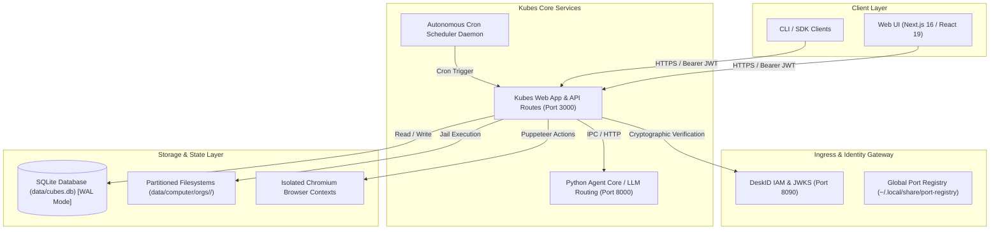

# Kubes System Architecture

## High-Level Topology

Kubes is an enterprise-grade autonomous specialist AI platform that enables domain-specific autonomous AI agents ("Cubes") to collaborate under the orchestration of a central coordination agent ("Maestro"). The architecture is built around strict multi-tenant isolation, cryptographic DeskID IAM, containerized/sandboxed tool execution, and an autonomous scheduled task and executive digest engine.

---

## Data Flow & Authentication Flow

1. **Client Request**: Client authenticates with DeskID IAM to receive an RS256/ES256 signed JWT bearing `sub` (User ID), `org_id` (Tenant ID), and `roles` (`admin`, `editor`, `viewer`).
2. **Server-Side Verification**: Next.js API route handlers invoke `requireAuth(request)`. The token is cryptographically validated against DeskID JWKS, producing an immutable, frozen `AuthContext`.
3. **Tenant-Scoped Access**: Every SQLite query and filesystem operation incorporates the authenticated `org_id` (e.g. `SELECT * FROM cubes WHERE id = ? AND org_id = ?`).
4. **Tool Execution & Sandboxing**: Specialized agents execute bash commands and Python scripts within tenant-partitioned jail directories (`data/computer/orgs/<orgId>/cubes/<slug>/`) backed by Linux Bubblewrap (`bwrap`) or secure seat-locked execution.
5. **Browser Automation**: Web browsing tools spawn dedicated Chromium instances per organization (`data/computer/orgs/<orgId>/chrome`), preventing cross-tenant cookie, cache, or DOM leakage.

---

## Network Boundaries & Ports

| Service | Default Port | Protocol | Scope | Description |
| :--- | :--- | :--- | :--- | :--- |
| `kubes-web` | 3000 | HTTP | Localhost / Ingress | Web application & Next.js App Router API |
| `kubes-agent-core` | 8000 | HTTP | Internal | Python uvicorn agent runtime & model provider routing |
| `deskid` | 8090 | HTTP | Internal / Auth | Cryptographic IAM, JWKS, and OAuth2 identity provider |
| `keymint` | 8080 | HTTP | Internal / Security | Secret management & encryption companion |
| `kubemind` | 9090 | HTTP | Internal / Vector | Semantic memory & vector indexing engine |
