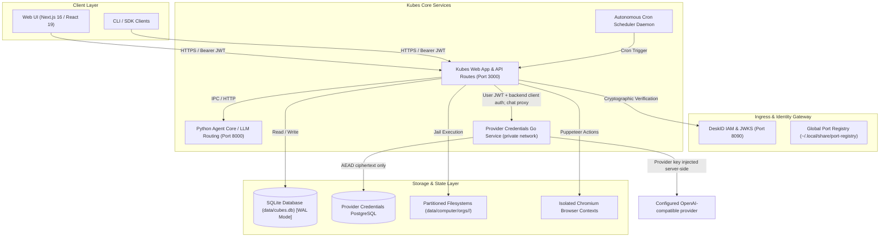
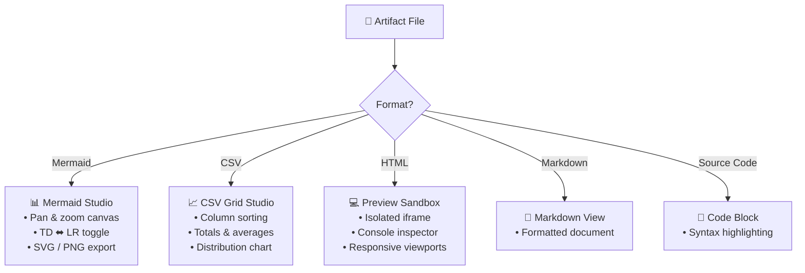

# Kubes System Architecture

## High-Level Topology

Kubes is an enterprise-grade autonomous specialist AI platform that enables domain-specific autonomous AI agents ("Cubes") to collaborate under the orchestration of a central coordination agent ("Maestro"). The architecture is built around strict multi-tenant isolation, cryptographic DeskID IAM, containerized/sandboxed tool execution, and an autonomous scheduled task and executive digest engine.

Provider credentials are personal to the authenticated `(tenant, principal)` pair. The browser submits a key only during an explicit save or consent-based import. Kubes sends subsequent model requests through the private credential service; that service owns encrypted PostgreSQL persistence and adds the key only to its outbound provider request. The credential service has no published port in the Compose topology. This integration is under implementation and still needs live database, identity, and provider verification.

---

## Data Flow & Authentication Flow

1. **Client Request**: Client authenticates with DeskID IAM to receive an RS256/ES256 signed JWT bearing `sub` (User ID), `org_id` (Tenant ID), and `roles` (`admin`, `editor`, `viewer`).
2. **Server-Side Verification**: Next.js API route handlers invoke `requireAuth(request)`. The token is cryptographically validated against DeskID JWKS, producing an immutable, frozen `AuthContext`.
3. **Tenant-Scoped Access**: Every SQLite query and filesystem operation incorporates the authenticated `org_id` (e.g. `SELECT * FROM cubes WHERE id = ? AND org_id = ?`).
4. **Tool Execution & Sandboxing**: Specialized agents execute bash commands and Python scripts within tenant-partitioned jail directories (`data/computer/orgs/<orgId>/cubes/<slug>/`) backed by Linux Bubblewrap (`bwrap`) or secure seat-locked execution.
5. **Browser Automation**: Web browsing tools spawn dedicated Chromium instances per organization (`data/computer/orgs/<orgId>/chrome`), preventing cross-tenant cookie, cache, or DOM leakage.

---

## Network Boundaries & Ports

| Service | Default Port | Protocol | Scope | Description |
| :--- | :--- | :--- | :--- | :--- |
| `kubes-web` | 3000 | HTTP | Localhost / Ingress | Web application & Next.js App Router API |
| `kubes-agent-core` | 8000 | HTTP | Internal | Python uvicorn agent runtime & model provider routing |
| `deskid` | 8090 | HTTP | Internal / Auth | Cryptographic IAM, JWKS, and OAuth2 identity provider |
| `keymint` | 8080 | HTTP | Internal / Security | Secret management & encryption companion |
| `kubemind` | 9090 | HTTP | Internal / Vector | Semantic memory & vector indexing engine |

---

## Sandboxing & Execution Isolation: Comparative Architectural Analysis

Kubes’ execution model is designed for low-latency local and team environments. The following analysis compares Kubes with two state-of-the-art agent sandboxing architectures: **NVIDIA OpenShell** (`NVIDIA/OpenShell`) and **Cloudflare Computer** (`cloudflare/computer`).

### Architectural Topology Comparison

```mermaid
flowchart TD
    subgraph Kubes["Kubes: Local-First Linux Namespace Isolation"]
        K_Agent["Specialist Cube"] --> K_Bwrap["Bubblewrap (bwrap)"]
        K_Bwrap --> K_NS["Unprivileged Linux Namespaces (Mount, PID, Network)"]
        K_NS --> K_Jail["Partitioned Directory Jail (data/computer/orgs/<org>/<cube>)"]
        K_Agent --> K_Browser["Per-Tenant Isolated Chromium (orgBrowsers Map)"]
    end

    subgraph OpenShell["NVIDIA OpenShell: Supervisor-Gated Enterprise Sandboxes"]
        O_Agent["Autonomous Agent"] --> O_Sandbox["MicroVM / Podman Container"]
        O_Sandbox --> O_Supervisor["Supervisor Egress Proxy"]
        O_Supervisor --> O_Policy["Declarative YAML Policies + Formal Prover"]
        O_Supervisor --> O_Inject["Externalized Credential Injection on Egress"]
        O_Sandbox --> O_Sentry["NVIDIA Sentry (BlueField DPU Hardware Watchdog)"]
    end

    subgraph CFComputer["Cloudflare Computer: Edge Virtual Filesystem"]
        C_Agent["Edge Agent"] --> C_Isolate["Dynamic V8 Worker Isolate"]
        C_Isolate --> C_Bash["just-bash (WebAssembly Shell)"]
        C_Isolate --> C_Container["FUSE Sandbox Container Mount"]
        C_Bash --> C_DO[("Virtual Filesystem in SQLite (Durable Object)")]
        C_Container --> C_DO
    end
```

### Feature & Capability Matrix

| Architectural Dimension | **Kubes (This Platform)** | **NVIDIA OpenShell** | **Cloudflare Computer** |
| :--- | :--- | :--- | :--- |
| **Primary Domain** | Interactive Desktop & Team Agent Platform | Enterprise Zero-Trust Agent Runtime | Serverless Distributed Edge Agent Sandbox |
| **Execution Sandbox** | **Bubblewrap (`bwrap`)** unprivileged namespaces + Docker fallback | **MicroVMs / Podman / Docker** with hardware watchdog | **V8 Isolates / WebAssembly (`just-bash`) / FUSE** |
| **Filesystem Model** | Physical partitioned host directory trees | Container volume mounts + path allowlists | Virtual filesystem backed authoritatively by **SQLite** |
| **Execution Latency** | Sub-millisecond (&lt;1ms) native execution | Container/MicroVM startup latency (100ms–2s) | Instant Worker isolate spin-up; container on-demand |
| **Browser Isolation** | Dedicated per-tenant Chromium process & user profile | Proxied via supervisor gateway | Cloudflare Workers Browser Rendering integration |
| **Network & Egress** | Dynamic `port-alloc` + SSRF IP filtering | Out-of-band **Supervisor proxy** + strict allowlists | Cloudflare Edge firewall & network bindings |
| **Secret Management** | Cryptographic DeskID JWT/JWKS; local `.env` | **Zero-Knowledge**: Keys injected at egress proxy | Cloudflare Secrets & Worker bindings |
| **Maturity & Scope** | Full-stack platform with chat UI, memory & scheduler | Dedicated runtime security infrastructure | Developer Preview / experimental edge library |

### Implemented Strategic Architectural Protections

The comparative architectural analysis directly shaped the following core protections now active across Kubes:

1. **Out-of-Band Credential Proxying & Token Sanitization (OpenShell Pattern)** (`lib/computer/egress_proxy.ts`):
   - Environment variables stripped of tokens (`OPENAI_API_KEY`, `ANTHROPIC_API_KEY`, etc.) via `config/security.json` before entering sandboxed processes.
   - Outbound agent HTTP requests route through local egress proxy with dynamic bearer token injection.
2. **Declarative Per-Cube Tool & Network Policies (OpenShell Pattern)** (`lib/cubes/policy.ts`):
   - Declarative manifests in `config/cubes.json` enforce allowed tools, network egress (`none`, `restricted`, `full`), and filesystem scopes.
   - `BwrapDriver` applies `--unshare-net` unless the Cube manifest explicitly allows network access.
3. **WebAssembly Shell Fallback (`just-bash` / Cloudflare Computer Pattern)** (`lib/computer/wasi_shell.ts`):
   - In-memory virtual POSIX shell isolate providing safe, zero-ambient-authority execution inside the workspace directory when Linux namespaces or Docker are unavailable.
4. **Hybrid Semantic Memory Integration with Companion `kubemind`** (`lib/memory/kubemind.ts`):
   - Port 9090 hybrid dense/sparse vector embedding lookups blended with SQLite lexical search via Reciprocal Rank Fusion (RRF).

---

## Interactive Visual Artifact Studio & Live Canvas Engine

The platform incorporates a visual artifact studio (`components/artifact-canvas.tsx`, `components/studios/`) that renders and executes agent deliverables:

### Studio Isolation & Rendering Specifications

1. **Mermaid Studio (`components/studios/mermaid-studio.tsx`)**:
   - Dynamic client-side dark theme Mermaid initialization.
   - Smooth mouse drag pan with boundary clamping and wheel zoom (`0.2x` - `4.0x`).
   - Dynamic orientation toggling (`cleanMermaidSource`, `toggleDiagramOrientation` in `lib/computer/diagram.ts`).
   - 1-click **SVG Export** and high-DPI **PNG Export** on dark canvas (`#0c0c0e`).

2. **CSV Grid Studio (`components/studios/csv-grid-studio.tsx`)**:
   - RFC-4180 parsing with quotes and escaped quote handling (`lib/computer/csv_grid.ts`).
   - Interactive table grid with client-side column sorting (`▲`/`▼`), real-time type-ahead search, and row count metrics.
   - Column metrics calculations (`Σ Sum`, `Avg`) rendered in a sticky table footer.
   - Native SVG bar distribution charts with category and metric column selectors, percentages, and gradients.

3. **Live Sandboxed Preview Runner (`components/studios/preview-sandbox.tsx`)**:
   - Strict `sandbox="allow-scripts"` iframe without `allow-same-origin`, preventing DOM/cookie/storage access to the host app.
   - Injected console interceptor script (`lib/computer/sandbox_preview.ts`) capturing `console.log`, `info`, `warn`, `error`, and unhandled rejections via `window.parent.postMessage`.
   - Collapsible console inspector drawer with level badges, message counter, and error indicators.
   - Multi-device viewport toggling (100% Responsive, Desktop 1024px, Tablet 768px, Mobile 375px) with one-click reload.

