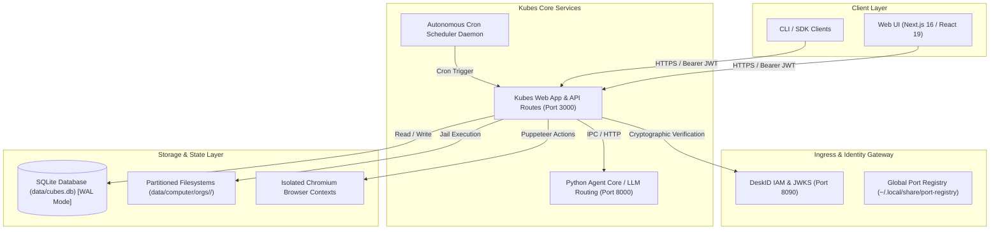

# Kubes System Architecture

## High-Level Topology

Kubes is an enterprise-grade autonomous specialist AI platform that enables domain-specific autonomous AI agents ("Cubes") to collaborate under the orchestration of a central coordination agent ("Maestro"). The architecture is built around strict multi-tenant isolation, cryptographic DeskID IAM, containerized/sandboxed tool execution, and an autonomous scheduled task and executive digest engine.

---

## Data Flow & Authentication Flow

1. **Client Request**: Client authenticates with DeskID IAM to receive an RS256/ES256 signed JWT bearing `sub` (User ID), `org_id` (Tenant ID), and `roles` (`admin`, `editor`, `viewer`).
2. **Server-Side Verification**: Next.js API route handlers invoke `requireAuth(request)`. The token is cryptographically validated against DeskID JWKS, producing an immutable, frozen `AuthContext`.
3. **Tenant-Scoped Access**: Every SQLite query and filesystem operation incorporates the authenticated `org_id` (e.g. `SELECT * FROM cubes WHERE id = ? AND org_id = ?`).
4. **Tool Execution & Sandboxing**: Specialized agents execute bash commands and Python scripts within tenant-partitioned jail directories (`data/computer/orgs/<orgId>/cubes/<slug>/`) backed by Linux Bubblewrap (`bwrap`) or secure seat-locked execution.
5. **Browser Automation**: Web browsing tools spawn dedicated Chromium instances per organization (`data/computer/orgs/<orgId>/chrome`), preventing cross-tenant cookie, cache, or DOM leakage.

---

## Network Boundaries & Ports

| Service | Default Port | Protocol | Scope | Description |
| :--- | :--- | :--- | :--- | :--- |
| `kubes-web` | 3000 | HTTP | Localhost / Ingress | Web application & Next.js App Router API |
| `kubes-agent-core` | 8000 | HTTP | Internal | Python uvicorn agent runtime & model provider routing |
| `deskid` | 8090 | HTTP | Internal / Auth | Cryptographic IAM, JWKS, and OAuth2 identity provider |
| `keymint` | 8080 | HTTP | Internal / Security | Secret management & encryption companion |
| `kubemind` | 9090 | HTTP | Internal / Vector | Semantic memory & vector indexing engine |

---

## Sandboxing & Execution Isolation: Comparative Architectural Analysis

Kubes’ execution model is designed for low-latency local and team environments. The following analysis compares Kubes with two state-of-the-art agent sandboxing architectures: **NVIDIA OpenShell** (`NVIDIA/OpenShell`) and **Cloudflare Computer** (`cloudflare/computer`).

### Architectural Topology Comparison

```mermaid
flowchart TD
    subgraph Kubes["Kubes: Local-First Linux Namespace Isolation"]
        K_Agent["Specialist Cube"] --> K_Bwrap["Bubblewrap (bwrap)"]
        K_Bwrap --> K_NS["Unprivileged Linux Namespaces (Mount, PID, Network)"]
        K_NS --> K_Jail["Partitioned Directory Jail (data/computer/orgs/<org>/<cube>)"]
        K_Agent --> K_Browser["Per-Tenant Isolated Chromium (orgBrowsers Map)"]
    end

    subgraph OpenShell["NVIDIA OpenShell: Supervisor-Gated Enterprise Sandboxes"]
        O_Agent["Autonomous Agent"] --> O_Sandbox["MicroVM / Podman Container"]
        O_Sandbox --> O_Supervisor["Supervisor Egress Proxy"]
        O_Supervisor --> O_Policy["Declarative YAML Policies + Formal Prover"]
        O_Supervisor --> O_Inject["Externalized Credential Injection on Egress"]
        O_Sandbox --> O_Sentry["NVIDIA Sentry (BlueField DPU Hardware Watchdog)"]
    end

    subgraph CFComputer["Cloudflare Computer: Edge Virtual Filesystem"]
        C_Agent["Edge Agent"] --> C_Isolate["Dynamic V8 Worker Isolate"]
        C_Isolate --> C_Bash["just-bash (WebAssembly Shell)"]
        C_Isolate --> C_Container["FUSE Sandbox Container Mount"]
        C_Bash --> C_DO[("Virtual Filesystem in SQLite (Durable Object)")]
        C_Container --> C_DO
    end
```

### Feature & Capability Matrix

| Architectural Dimension | **Kubes (This Platform)** | **NVIDIA OpenShell** | **Cloudflare Computer** |
| :--- | :--- | :--- | :--- |
| **Primary Domain** | Interactive Desktop & Team Agent Platform | Enterprise Zero-Trust Agent Runtime | Serverless Distributed Edge Agent Sandbox |
| **Execution Sandbox** | **Bubblewrap (`bwrap`)** unprivileged namespaces + Docker fallback | **MicroVMs / Podman / Docker** with hardware watchdog | **V8 Isolates / WebAssembly (`just-bash`) / FUSE** |
| **Filesystem Model** | Physical partitioned host directory trees | Container volume mounts + path allowlists | Virtual filesystem backed authoritatively by **SQLite** |
| **Execution Latency** | Sub-millisecond (&lt;1ms) native execution | Container/MicroVM startup latency (100ms–2s) | Instant Worker isolate spin-up; container on-demand |
| **Browser Isolation** | Dedicated per-tenant Chromium process & user profile | Proxied via supervisor gateway | Cloudflare Workers Browser Rendering integration |
| **Network & Egress** | Dynamic `port-alloc` + SSRF IP filtering | Out-of-band **Supervisor proxy** + strict allowlists | Cloudflare Edge firewall & network bindings |
| **Secret Management** | Cryptographic DeskID JWT/JWKS; local `.env` | **Zero-Knowledge**: Keys injected at egress proxy | Cloudflare Secrets & Worker bindings |
| **Maturity & Scope** | Full-stack platform with chat UI, memory & scheduler | Dedicated runtime security infrastructure | Developer Preview / experimental edge library |

### Implemented Strategic Architectural Protections

The comparative architectural analysis directly shaped the following core protections now active across Kubes:

1. **Out-of-Band Credential Proxying & Token Sanitization (OpenShell Pattern)** (`lib/computer/egress_proxy.ts`):
   - Environment variables stripped of tokens (`OPENAI_API_KEY`, `ANTHROPIC_API_KEY`, etc.) via `config/security.json` before entering sandboxed processes.
   - Outbound agent HTTP requests route through local egress proxy with dynamic bearer token injection.
2. **Declarative Per-Cube Tool & Network Policies (OpenShell Pattern)** (`lib/cubes/policy.ts`):
   - Declarative manifests in `config/cubes.json` enforce allowed tools, network egress (`none`, `restricted`, `full`), and filesystem scopes.
   - `BwrapDriver` applies `--unshare-net` unless the Cube manifest explicitly allows network access.
3. **WebAssembly Shell Fallback (`just-bash` / Cloudflare Computer Pattern)** (`lib/computer/wasi_shell.ts`):
   - In-memory virtual POSIX shell isolate providing safe, zero-ambient-authority execution inside the workspace directory when Linux namespaces or Docker are unavailable.
4. **Hybrid Semantic Memory Integration with Companion `kubemind`** (`lib/memory/kubemind.ts`):
   - Port 9090 hybrid dense/sparse vector embedding lookups blended with SQLite lexical search via Reciprocal Rank Fusion (RRF).

