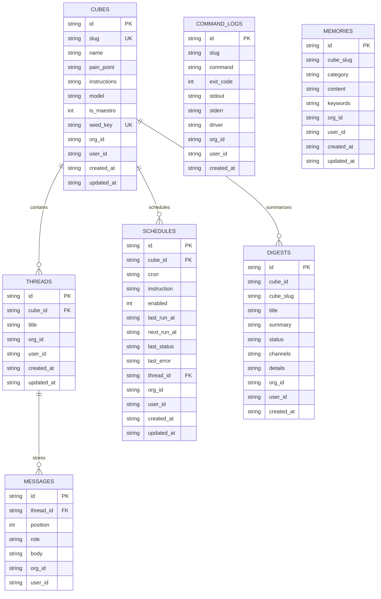

# Database Schema & Data Models

Kubes utilizes SQLite in **WAL (Write-Ahead Logging)** mode via `better-sqlite3`. All primary entity tables incorporate compound indexes and foreign key relationships enforcing strict multi-tenant isolation.

---

## Performance Indexes

- `threads_cube_updated`: `(cube_id, updated_at DESC)`
- `threads_org_updated`: `(org_id, updated_at DESC)`
- `messages_thread_position`: `(thread_id, position)`
- `schedules_org`: `(org_id, next_run_at ASC)`
- `command_logs_slug_created`: `(slug, created_at DESC)`
- `command_logs_org_created`: `(org_id, created_at DESC)`
- `memories_slug_category`: `(cube_slug, category)`
- `memories_org_category`: `(org_id, category)`
- `digests_created`: `(created_at DESC)`
- `digests_org_created`: `(org_id, created_at DESC)`
- `digests_cube`: `(cube_id, created_at DESC)`
