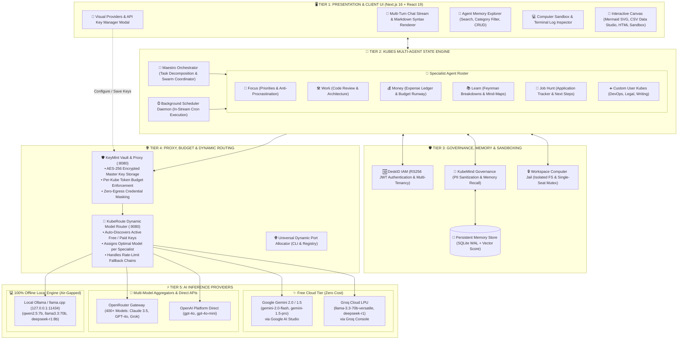
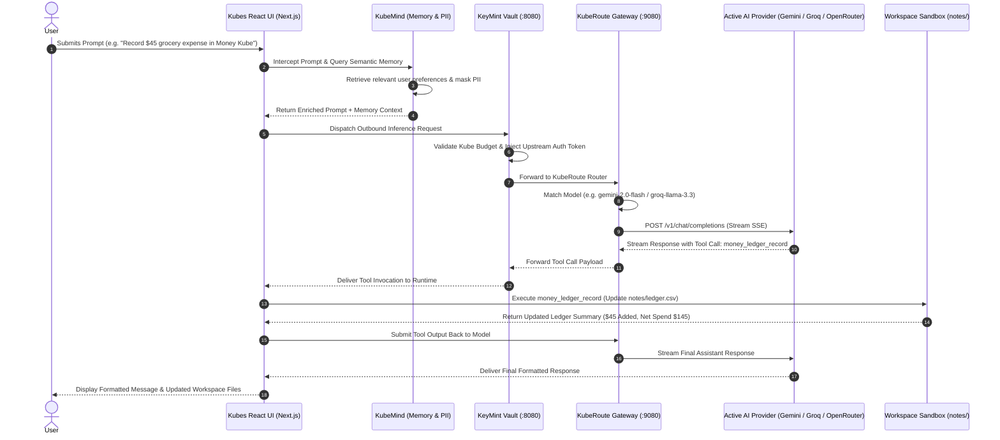
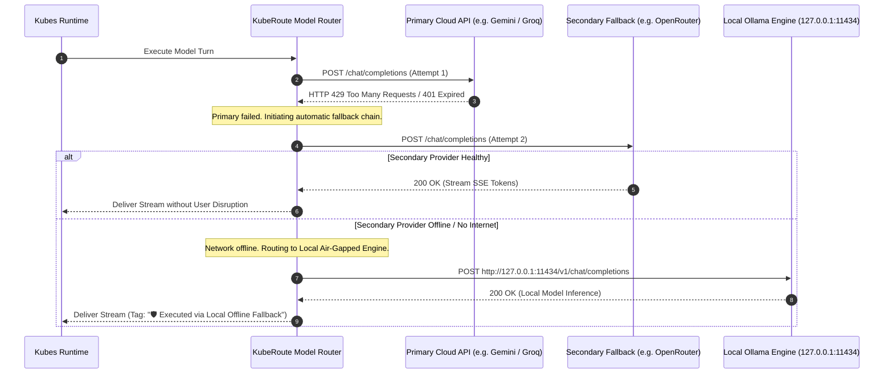

# 🏛️ Kubes: End-to-End System Architecture & Integration Guide

This document defines the comprehensive 5-tier system architecture, multi-agent execution pipeline, security governance, and multi-provider AI integration for **Kubes** (Autonomous Local Multi-Agent Workstation).

---

## Table of Contents
1. [Architectural Principles & Core Mental Model](#1-architectural-principles--core-mental-model)
2. [5-Tier End-to-End Architecture Diagram](#2-5-tier-end-to-end-architecture-diagram)
3. [Component Deep Dives & Responsibilities](#3-component-deep-dives--responsibilities)
4. [Integration Data Flows & Sequence Diagrams](#4-integration-data-flows--sequence-diagrams)
5. [Multi-Provider Inference & KeyMint Integration](#5-multi-provider-inference--keymint-integration)
6. [Operational Lifecycle & Port Allocation](#6-operational-lifecycle--port-allocation)
7. [Security, Privacy & Governance Invariants](#7-security-privacy--governance-invariants)

---

## 1. Architectural Principles & Core Mental Model

Kubes is designed as a **local-first, zero-trust autonomous AI workstation**. Instead of relying on a single cloud vendor or an ephemeral chatbot session, Kubes operates as a persistent ecosystem of specialized agents with shared memory, sandboxed execution, and multi-provider inference resilience.

```
┌─────────────────────────────────────────────────────────────────────────────────┐
│                           CORE ARCHITECTURAL INVARIANTS                         │
├─────────────────────────────────────────────────────────────────────────────────┤
│ 1. Zero Vendor Lock-In: Dynamic failover across Gemini, Groq, OpenRouter & Ollama│
│ 2. Zero Credential Leakage: Raw keys secured in KeyMint vault (:8080)           │
│ 3. In-Stream Task Execution: Scheduled tasks execute directly in Kube threads   │
│ 4. Persistent Local Memory: Cross-thread semantic recall stored in SQLite WAL   │
│ 5. Sandboxed Filesystem: Scoped workspace directories (notes/, artifacts/)      │
│ 6. Zero Information Leakage: Host usernames and private IPs stripped everywhere │
└─────────────────────────────────────────────────────────────────────────────────┘
```

---

## 2. 5-Tier End-to-End Architecture Diagram



---

## 3. Component Deep Dives & Responsibilities

### Tier 1: Presentation & Client UI (Next.js 16 + React 19)
- **`components/cubes-app.tsx`:** Primary single-page shell orchestrating active specialist state, navigation, modal drawers, and thread switching.
- **`components/cube-chat.tsx`:** Multi-turn streaming chat UI supporting Vercel AI SDK SSE protocol, tool call execution indicators, and error boundaries.
- **`components/memory-view.tsx`:** Real-time visual memory browser with keyword search, category pills (`preference`, `project`, `fact`, `instruction`, `general`), global vs per-Kube scope toggle, and full CRUD.
- **`components/cube-editor.tsx`:** Responsive drawer for live persona tuning, model selection, custom instruction editing, and in-stream cron schedule management with "New Cube" cancel and save workflows.
- **`components/computer-pane.tsx`:** Interactive workspace file explorer and live terminal execution log viewer.

---

### Tier 2: Kubes Multi-Agent Runtime
- **`👑 Maestro (Orchestrator):`** High-level task decomposition, swarm coordination, and routing to specialized sub-agents.
- **`🎯 Focus (Productivity):`** Procrastination elimination, Eisenhower matrix prioritization, and time-blocked execution.
- **`🛠️ Work (Engineering):`** Code review, Git repository inspection, and Mermaid system architecture diagramming (`notes/diagram.mmd`).
- **`💰 Money (Finance):`** CSV transaction recording (`notes/ledger.csv`), expense categorization, and net runway calculation.
- **`📚 Learn (Tutor):`** Feynman conceptual breakdowns, knowledge synthesis, and mind-map generation.
- **`💼 Job Hunt (Careers):`** Markdown pipeline tracking (`notes/applications.md`), resume tailoring, and interview preparation.
- **`⏰ Background Scheduler (`scripts/scheduler.ts`):`** Standalone ticker daemon claiming due recurring tasks via atomic SQLite row locking and streaming execution directly into the parent Kube's active thread.

---

### Tier 3: Governance, Identity & Shared Runtime
- **`DeskID IAM Adapter (`lib/auth/deskid.ts`):`** Enterprise identity provider validating RS256 JWKS tokens, enforcing role-based permissions (`roles.kubes`), and scoping tenant storage.
- **`KubeMind Governance (`services/agent-core/kubemind_adapter.py`):`** Zero-egress PII sanitization (masking emails, names, API keys) and semantic memory retrieval before prompt dispatch.
- **`Computer Sandbox Jail (`lib/computer/jail.ts` & `lib/computer/sandbox.ts`):`** Directory boundary enforcement, symlink breakout protection, and single-seat mutex execution lock across bash and headless Chrome.

---

### Tier 4: Proxy, Budget & Routing Gateway
- **`KeyMint Vault & Proxy (`:8080`):`**
  - AES-256 encrypted master API key storage.
  - Per-Kube monthly token budget enforcement (e.g. max $0/mo for Focus via Gemini Free, $5/mo for Work via DeepSeek).
  - Secret masking to ensure browser Javascript never handles raw provider keys.
- **`KubeRoute Model Router (`:9080` / `lib/ai/provider.ts`):`**
  - Auto-discovers active keys (`GEMINI_API_KEY`, `GROQ_API_KEY`, `OPENROUTER_API_KEY`, `OPENAI_API_KEY`, or local Ollama).
  - Smart specialist model assignment (fast 7B/Flash for routing, deep reasoning for coding).
  - Automatic rate-limit failover (HTTP 429 back-off $\to$ secondary provider $\to$ local Ollama).
- **`Universal Port Allocator (`tools/port-allocator/`):`**
  - Standalone dynamic port allocation engine managing collision-free ports across multi-process stacks with live PID lease tracking.

---

### Tier 5: AI Inference Providers
- **`Google Gemini (Free Tier):`** `gemini-2.0-flash`, `gemini-1.5-pro` via Google AI Studio (15 RPM free, 1M context window).
- **`Groq Cloud LPU (Free Tier):`** `llama-3.3-70b-versatile`, `deepseek-r1-distill-llama-70b` (sub-second streaming).
- **`OpenRouter Gateway:`** 400+ frontier models (Claude 3.5 Sonnet, GPT-4o, Grok 2, Mistral Large).
- **`OpenAI Direct:`** `gpt-4o`, `gpt-4o-mini`, `o3-mini`.
- **`Local Ollama / llama.cpp:`** 100% offline, air-gapped open-weights models (`qwen2.5:7b`, `llama3.3:70b`, `deepseek-r1:8b`).

---

## 4. Integration Data Flows & Sequence Diagrams

### Flow A: Multi-Provider Chat Execution with Memory & Tool Calling



---

### Flow B: Automatic Provider Failover & Offline Recovery



---

## 5. Multi-Provider Inference & KeyMint Integration

### Configuration Standards (`.env.local`)

To configure Kubes with any supported provider, configure `.env.local` using standard presets:

```ini
# ==============================================================================
# OPTION 1: GOOGLE GEMINI (100% Free via Google AI Studio)
# ==============================================================================
OPENAI_BASE_URL=https://generativelanguage.googleapis.com/v1beta/openai/
OPENAI_API_KEY=AIzaSyYourFreeGeminiKeyFromAIStudio
OPENAI_MODEL=gemini-2.0-flash

# ==============================================================================
# OPTION 2: GROQ CLOUD LPU (100% Free Ultra-Fast Streaming)
# ==============================================================================
# OPENAI_BASE_URL=https://api.groq.com/openai/v1
# OPENAI_API_KEY=gsk_your_free_groq_key
# OPENAI_MODEL=llama-3.3-70b-versatile

# ==============================================================================
# OPTION 3: OPENROUTER (400+ Frontier Models: Claude 3.5, GPT-4o, Grok)
# ==============================================================================
# OPENAI_BASE_URL=https://openrouter.ai/api/v1
# OPENAI_API_KEY=sk-or-v1-your-openrouter-key
# OPENAI_MODEL=openai/gpt-4o-mini

# ==============================================================================
# OPTION 4: 100% OFFLINE LOCAL OLLAMA (Zero Internet, Zero Cost)
# ==============================================================================
# OPENAI_BASE_URL=http://127.0.0.1:11434/v1
# OPENAI_API_KEY=ollama
# OPENAI_MODEL=qwen2.5:7b

# ==============================================================================
# OPTION 5: KEYMINT ZERO-TRUST PROXY (Recommended for Production)
# ==============================================================================
# OPENAI_BASE_URL=http://localhost:8080/v1
# OPENAI_API_KEY=km_local_virtual_token
```

---

## 6. Operational Lifecycle & Port Allocation

The entire stack is coordinated via the standalone **Universal Port Allocator** (`tools/port-allocator/`), ensuring deterministic, collision-free port leases:

```bash
# Start multi-process stack with dynamic port allocation & PID lease tracking
./scripts/start-all.sh

# Status dashboard with live health checks & port registry inspection
./scripts/status.sh

# Execute automated E2E browser UI test playbook
pnpm test:ui

# Execute full multi-language verification suite
pnpm run verify

# Gracefully terminate all services and release port leases
./scripts/stop-all.sh
```

---

## 7. Security, Privacy & Governance Invariants

1. **Zero Information Leakage:**
   - Host usernames, full home directory paths (`/home/...`), and private internal IP addresses (`192.168.x.x`, `10.x.x.x`) are sanitized from all logs, transcripts, and git commits.
2. **Deterministic Workspace Sandboxing:**
   - Specialists write only to their designated folders under `data/computer/`. Maestro can read across directories to coordinate work, but cannot overwrite specialist files directly without explicit delegation.
3. **Single-Seat Mutex Lock:**
   - Terminal commands and headless browser sessions acquire a single-seat lock (`lib/computer/busy.ts`), preventing concurrent race conditions.
4. **Non-Breaking Verification Gate:**
   - Every code change must pass 100% of unit tests (Node.js test runner), Python LangGraph pytest (17/17), Port Allocator tests (6/6), TypeScript typechecks, and Puppeteer E2E browser tests (`pnpm test:ui`).
