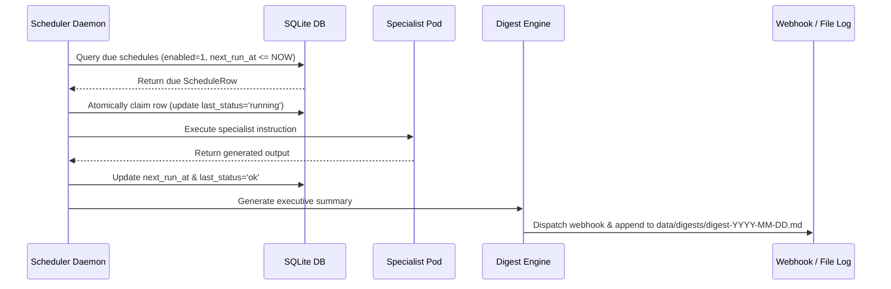

# Operational Runbook: Scheduled Events & Digest Pipeline

## Autonomous Cron Pipeline

The Kubes scheduler daemon runs continuously every 30 seconds (`tick()` interval).



---

## Event Payload Formats

### Webhook Digest Payload
```json
{
  "text": "### ✅ [Acme Corp Finance] Task Completed\n\n• **Instruction**: Daily liquidity check\n• **Outcome**: Cash balance verified: $1.2M",
  "digestId": "e305e7c8-8888-4231-9f2b-8a21133a8c12",
  "cubeSlug": "finance",
  "title": "✅ [Acme Corp Finance] Task Completed",
  "summary": "• **Outcome**: Cash balance verified: $1.2M",
  "status": "ok",
  "timestamp": "2026-10-06T09:00:00.000Z"
}
```
